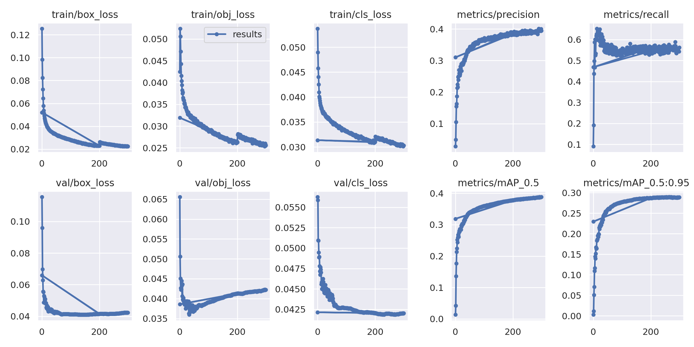
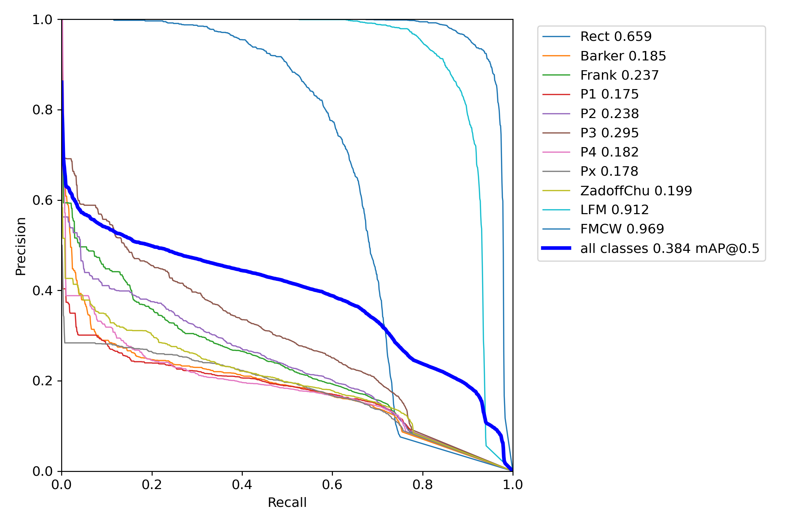
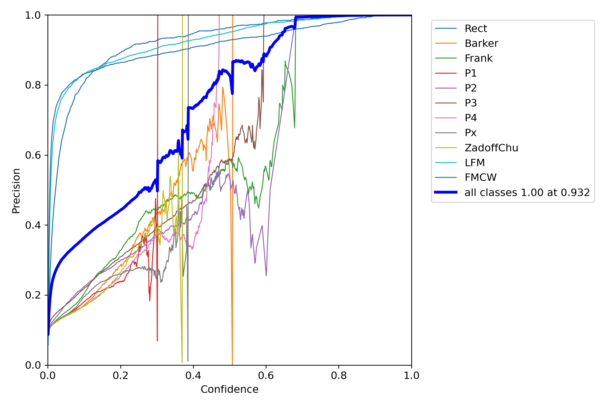
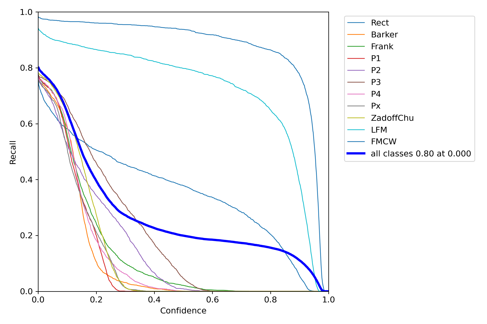
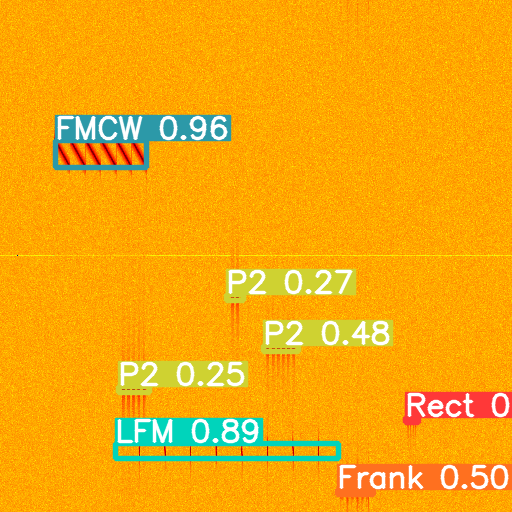
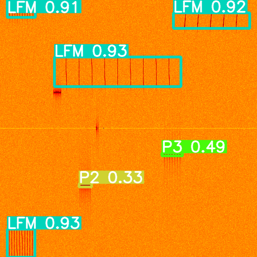
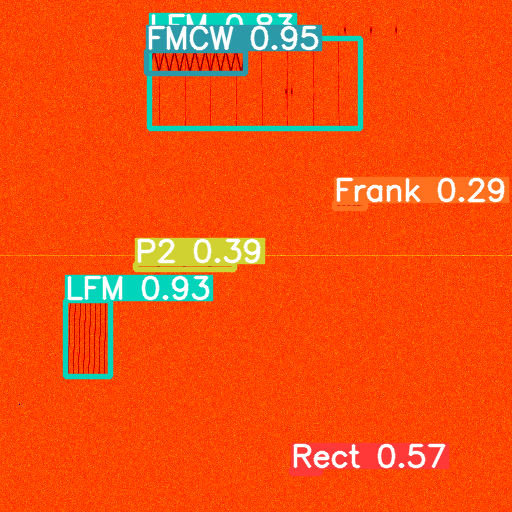
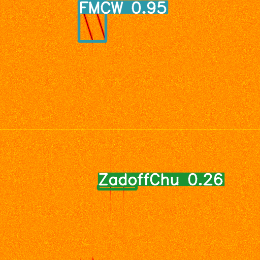

# EMS-YOLO: Spectrum Analyzer for Signal Detection

A deep learning-based spectrum analyzer that detects and classifies radar signals from spectrograms using an enhanced YOLO object detection framework. Built on the EMS-YOLO codebase, this project detects 11 different signal types in spectrogram images.

For more in-depth details about the model architecture, use-cases and configurability options, please check out the detailed documentation here : https://type1compute.github.io/docs/intro

## Overview

This project implements a spectrum analyzer capable of detecting and classifying multiple types of radar signals from spectrogram images. The system uses a modified YOLO architecture based on ResNet-18 backbone, optimized for signal detection tasks.

**Key Capabilities:**
- Multi-class signal detection (11 signal types)
- Real-time inference on 512×512 spectrogram images
- High precision (100% at confidence >0.9)
- Robust performance across various signal characteristics

## Model Architecture

**Backbone:** ResNet-18 with BasicBlock layers
- Input: 512×512 spectrogram images (3 channels)
- Feature extraction: Multi-scale feature maps

**Detection Head:**
- Two detection scales (P4/16 and P5/32)
- Predefined anchors optimized for signal detection
- 11-class classification head

**Key Features:**
- Time window integration (5-frame temporal windows)
- Signal-specific anchor boxes
- Multi-scale detection

## Dataset

The model is trained on the **RadDet** dataset:
- **Source:** [GitHub](https://github.com/abcxyzi/RadDet) | [Kaggle](https://www.kaggle.com/datasets/raddet)
- **Version:** RadDet40k512HW009Tv2
- **Size:** ~40,000 images (512×512 pixels)
- **Classes:** Rect, Barker, Frank, P1-P4, Px, ZadoffChu, LFM, FMCW

## Installation

**Prerequisites:** Python 3.8+, CUDA-capable GPU, PyTorch 2.0+

```bash
# Clone repository
git clone https://github.com/type1compute/Spectrum-Analyzer.git
cd Spectrum-Analyzer

# Install dependencies
pip install -r requirements.txt

# Install PyTorch with CUDA (choose appropriate version)
pip install torch>=2.0.0+cu118 torchvision>=0.15.0+cu118 --extra-index-url https://download.pytorch.org/whl/cu118
```

**Dataset Setup:**
1. Download RadDet dataset from Kaggle
2. Extract and update path in `data/raddet.yaml`

## Usage

**Training:**
```bash
python train.py --data data/raddet.yaml --cfg models/resnet18.yaml --imgsz 512 --epochs 300 --batch-size 64 --device 0
```

**Validation:**
```bash
python val.py --weights runs/train/exp28/weights/best.pt --data data/raddet.yaml --task test --imgsz 512
```

**Detection:**
```bash
python detect.py --weights runs/train/exp28/weights/best.pt --source path/to/images --imgsz 512 --conf-thres 0.25
```

**Quantization:**
```bash
python quantize_model.py --weights arch/epoch_300_model_binary.pt --quant-type static_int8 --data data/raddet.yaml --output quantized_models/
```

## Pre-trained Models

pre-trained models are available at: https://drive.google.com/drive/folders/1z-cGQhVtElTe6ZCqa5bihQ8guwyl9kaG?usp=sharing

**Performance:**
- Training epochs: 300
- Input resolution: 512×512
- mAP@0.5: 0.39
- mAP@0.5:0.95: 0.29

**Usage:**
```python
from models.common import DetectMultiBackend

model = DetectMultiBackend('runs/train/exp28/weights/best.pt', device='cuda')
model.eval()
results = model(image)
```

## Results & Performance

### Overall Metrics

| Metric | Value |
|--------|-------|
| Precision | 0.39 |
| Recall | 0.55-0.58 |
| mAP@0.5 | 0.39 |
| mAP@0.5:0.95 | 0.29 |
| F1 Score | ~0.46 |

### Per-Class Performance

**High-Performing Classes:**
- FMCW: AP = 0.969
- LFM: AP = 0.912
- Rect: AP = 0.659

**Other Classes:** P3 (0.295), P2 (0.238), Frank (0.237), ZadoffChu (0.199), Barker (0.185), P4 (0.182), Px (0.178), P1 (0.175)

### Performance Analysis

The model achieves **100% precision at confidence threshold 0.932**, indicating high reliability for confident detections. The mAP@0.5:0.95 (0.29) being lower than mAP@0.5 (0.39) suggests that while the model correctly identifies signals, bounding box localization may not perfectly cover the entire signal extent. This is common when bounding boxes cover full width but partial height of signals. For the purpose of signal detection, lower map score is acceptable as it is not a indicator of accuracy. **As long as the model confidence score is high, the map score doesn't matter as much since we are more concerned with signal detection rather than the iou for the detected signal to cover the entire signal height.**

### Training Curves



### Performance Visualization







## Detection Examples

Sample detection results showing accurate signal localization and multi-class detection:









Over 2000 detection results are available in `runs/detect/exp5/` for comprehensive evaluation.

## Project Structure

```
EMS-YOLO/
├── data/
│   ├── raddet.yaml          # Dataset configuration
│   └── raddet_gt/           # Ground truth annotations
├── models/
│   ├── resnet18.yaml        # ResNet-18 model configuration
│   ├── yolo.py              # YOLO model implementation
│   └── common.py            # Common model utilities
├── utils/
│   ├── datasets.py          # Dataset loading utilities
│   ├── metrics.py           # Evaluation metrics
│   └── general.py           # General utilities
├── runs/
│   ├── train/exp28/         # Training results and weights
│   └── detect/exp5/         # Detection results
├── train.py                 # Training script
├── val.py                   # Validation script
├── detect.py                # Detection/inference script
└── quantize_model.py        # Model quantization
```

## Citation

If you use this code or the RadDet dataset, please cite:

```bibtex
@article{raddet2021,
  title={RadDet: Radar Signal Detection Dataset},
  author={RadDet Authors},
  journal={GitHub Repository},
  year={2021},
  url={https://github.com/abcxyzi/RadDet}
}
```

## License

This project is based on the EMS-YOLO codebase. Please refer to the LICENSE file for details.

## Acknowledgments

- RadDet Dataset for the comprehensive radar signal detection dataset
- EMS-YOLO for the base YOLO implementation
- YOLOv5/Ultralytics for the YOLO architecture inspiration

---

**Note:** This model is optimized for spectrogram-based signal detection. For best results, ensure input images are properly preprocessed.
